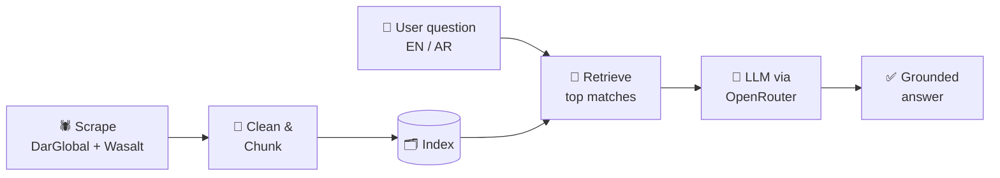

<div align="center">


<a href="https://git.io/typing-svg">
  
</a>

<br/>


<br/>

[](https://www.linkedin.com/in/mohamed-hamdy-728757282/)
[](mailto:mohamed.hamdey.hafez@gmail.com)
[](https://leetcode.com/)

</div>

---

<div align="center">

```text
 INPUT          HIDDEN          HIDDEN          OUTPUT

  (●)───┐        (●)───┐        (●)───┐
  (●)───┼──────→ (●)───┼──────→ (●)───┼──────→  [ PREDICTION ]
  (●)───┘        (●)───┘        (●)───┘
```

</div>

---

## 🧠 `> whoami`

```python
class MohamedHamdy:
    def __init__(self):
        self.role       = "AI / Computer Vision Engineer"
        self.education  = "B.Sc. Computer Science, Minia University (2026), GPA 3.6/4.0"
        self.focus      = ["Computer Vision", "NLP", "RAG Systems", "OCR"]
        self.based_in   = "Cairo, Egypt 🇪🇬"
        self.background = "National-level Kung Fu athlete (Egypt, 2021) 🥋"
        self.military   = "Exempted"
        self.mission    = "Ship AI that is accurate, real-time, and genuinely useful"
        self.open_to    = ["ML / CV / Applied AI roles", "Research internships", "Collaborations"]

    def forward(self, curiosity):
        return self.mission if curiosity > 0 else None

    def philosophy(self):
        return "Train hard. Measure everything. Never stop iterating."
```

I build **AI systems that work in the real world**: a YOLOv11 vehicle detector serving a university of 15,000+ people, a real-time sign-language-to-speech system, and a bilingual RAG chatbot grounded in live real-estate data. Before code, there was the mat: years of competitive Kung Fu taught me the discipline, patience, and resilience I now bring to every training run.

---

## ⭐ `> latest_build`

<table>
<tr>
<td valign="top">

### 🏙️ DarGlobal · Wasalt RAG Assistant
**Bilingual (EN / AR) retrieval-augmented chatbot over real-estate data**

A full pipeline built end to end by one person on a free-tier budget: scrape public data from **DarGlobal** and **Wasalt**, index it, and answer questions grounded in what was actually scraped.

- 🕷️ **Ingestion:** Playwright-based scraping of DarGlobal pages and Wasalt listings
- 🔎 **Retrieval:** plain-Python RAG pipeline (no LangChain / LlamaIndex)
- 🤖 **Generation:** free OpenRouter model behind a **FastAPI** backend
- 🌍 **Bilingual:** English and Arabic support
- 🐳 **Shipped:** containerised with **Docker** and deployed with a live demo
- 🎨 **UI:** custom chat interface designed to match the DarGlobal website's look and feel

[](https://darglobal-rag.onrender.com/)
[](https://github.com/Mohamed-Hamdey/darglobal-rag)


> ⏳ The demo runs on a free host, so the first load can take a moment to wake up.

</td>
</tr>
</table>



---

## 🚀 `> featured_projects`

<table>
<tr>
<td width="50%" valign="top">

### 🚌 UniMove
**Smart Transportation · Graduation Project**

AI module for Minia University's transportation system, serving **15,000+ students & staff**.

- 🎯 **YOLOv11** vehicle detection → **94% mAP**
- 🔢 **OCR pipeline** for mileage extraction → **98% accuracy**
- 🗂️ **5,000+** images annotated with CVAT & Roboflow


</td>
<td width="50%" valign="top">

### 🤟 SignVision
**Real-Time Sign Language → Speech**

Webcam-based gesture recognition that speaks for the user.

- ⚡ Real-time inference with **TensorFlow + OpenCV**
- 🎯 **96% accuracy** across **15 gestures**
- 🔊 Speech-synthesis APIs for instant audio output


</td>
</tr>
<tr>
<td width="50%" valign="top">

### 👓 EchoLens
**Smart Glasses for the Hearing Impaired**

Assistive glasses that convert real-time environmental audio into **visual alerts**.

- 🎧 Python-based audio signal processing
- 👁️ Visual alerts for sounds around the user
- ♿ Built for accessibility and independence


</td>
<td width="50%" valign="top">

### 🛡️ Barq Systems · Network Anomaly Detector
**Prototype ML model for network traffic**

Built during my network internship.

- 🌐 Analysed **10+ routing and switching protocols**
- 🧪 Python + scikit-learn anomaly detection


</td>
</tr>
</table>

> 🔎 More on my [repositories page](https://github.com/Mohamed-Hamdey?tab=repositories).

---

## 🛠️ `> tech_stack`

<div align="center">

**🧠 AI / ML**


**💻 Languages**


**🌐 Backend, Data & Cloud**


</div>

---

## 🧭 `> training_log`

```text
2021  🥋 National-level Kung Fu athlete (Egypt)
2023  🎓 Intro to AI & Applications, Zewail City of Science and Technology
2023  💼 IT Intern @ DP World, Sokhna: 20+ bugs fixed, error rates cut by 15%
2024  🌐 Network Intern @ Barq Systems: ML anomaly detector across 10+ protocols
2024  📊 Machine Learning for Data Analysis, NTI
2024  👨‍🏫 Software Instructor @ iSchool DEMI: 500+ students taught
2025  🧠 Deep Learning Specialization, DeepLearning.AI
2026  💬 NLP Specialization, DeepLearning.AI
2026  🎓 B.Sc. Computer Science, Minia University, GPA 3.6 / 4.0
2026  🏙️ Shipped a bilingual RAG chatbot over DarGlobal & Wasalt data
NOW   🚀 Building AI systems & looking for the next big challenge
```

---

## 🥋 `> mat_to_model`

| On the mat 🥋 | In the lab 🧠 |
|:---|:---|
| Thousands of repetitions to perfect one form | Thousands of epochs to perfect one model |
| Read your opponent in real time | Detect and recognize in real time |
| Fall seven times, stand up eight | Debug, retrain, ship |
| Respect the fundamentals | Master the math before the framework |

---

## 📊 `> metrics`

<div align="center">


<br/>


<br/>


</div>

---

## 🐍 `> contribution_grid`

<div align="center">

<!-- Needs the snake GitHub Action (snake.yml). Delete this block if you skip it. -->
<picture>
  <source media="(prefers-color-scheme: dark)" srcset="https://raw.githubusercontent.com/Mohamed-Hamdey/Mohamed-Hamdey/output/github-snake-dark.svg" />
  <source media="(prefers-color-scheme: light)" srcset="https://raw.githubusercontent.com/Mohamed-Hamdey/Mohamed-Hamdey/output/github-snake.svg" />
  
</picture>

</div>

---

## 🎯 `> status: in_progress`

```diff
+ 🔭 Sharpening computer vision, RAG and real-time recognition systems
+ 📚 Deepening NLP after the DeepLearning.AI specialization
+ 🤝 Open to collaborations on assistive-tech and applied-AI projects
+ 💬 Ask me about: YOLO · OCR pipelines · RAG chatbots · teaching programming
+ ⚡ Fun fact: 500+ students taught, and a national stage fought on
```

---

<div align="center">

### 📫 `> connect.init()`

[](mailto:mohamed.hamdey.hafez@gmail.com)
[](https://www.linkedin.com/in/mohamed-hamdy-728757282/)


</div>
